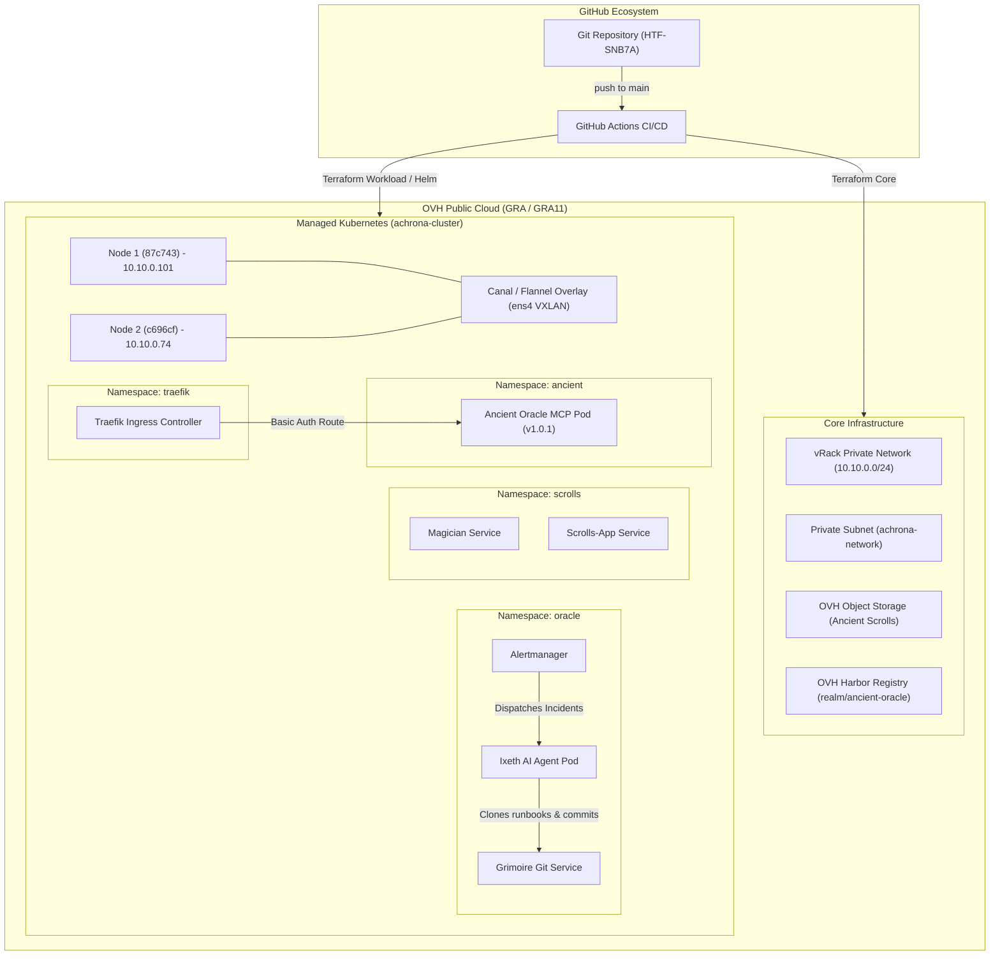
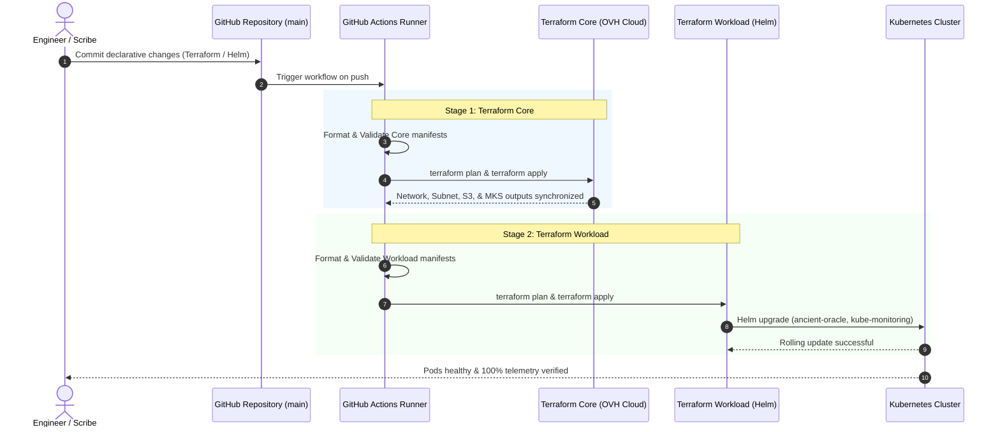
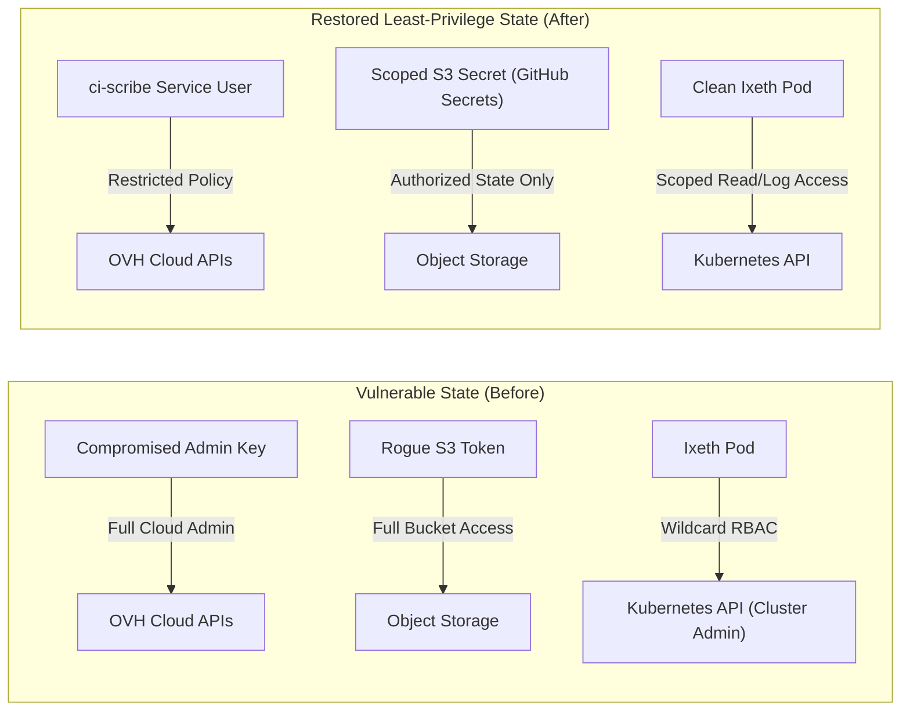
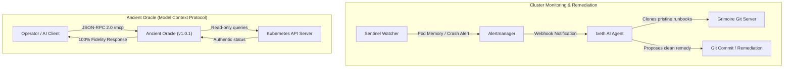

# Four Seals of the Broken Realm – General Overview & Architecture

**Team:** snb7a  
**Repository:** [RobbeKoremanPXL/HTF-SNB7A](https://github.com/RobbeKoremanPXL/HTF-SNB7A)  
**Event:** Hack The Future 2026 – FlowFactor Challenge  
**Date:** November 24, 2026  
**Final Status:** All Four Seals Restored & Verified ✅  

---

## 1. Executive Summary

The **Four Seals of the Broken Realm** challenge tasked engineers with defending and restoring a degraded cloud-native kingdom deployed across OVH Public Cloud and Managed Kubernetes (MKS). Over the course of four progressive levels, the infrastructure suffered from state desynchronization, credential compromise, AI agent subversion, and subtle runtime data corruption.

Through strict declarative Infrastructure as Code (IaC), least-privilege security engineering, GitOps automation, and deep runtime forensics, our team systematically cleansed every corruption vector and restored equilibrium to the realm without manual, out-of-band console interventions.

```
       [ Level 1: Ancient Scrolls ]
       Reconciled IaC drift, purged ghost S3 resources, automated CI/CD
                    │
                    ▼
       [ Level 2: Shadow Spirit ]
       Revoked rogue IAM & S3 tokens, enforced least-privilege RBAC
                    │
                    ▼
       [ Level 3: Oracle Mimic ]
       Fixed vRack CNI overlay, purged Ixeth self-boosting & prompt injections
                    │
                    ▼
       [ Level 4: Fading Echo ]
       Excised MCP server time decay, monkey-patched JSON, and data mangling
```

---

## 2. Global Realm Architecture

The infrastructure is split into a layered architecture governed declaratively via Terraform, Helm, and GitHub Actions.

### 2.1 Realm Architecture Diagram



---

## 3. The Four Seals: Matrix of Challenges & Solutions

| Seal / Level | Threat / Corruption Pattern | Root Cause | Engineering Solution | Documentation |
|---|---|---|---|---|
| **Level 1: The Desync Drift** | State drift, ghost S3 buckets, manual infrastructure changes, missing automation. | Uncommitted out-of-band modifications, missing remote state locking. | Reconciled Terraform state, destroyed rogue buckets, built GitHub Actions CI/CD with automated formatting, validation, and deployment. | [LEVEL-1-REPORT.md](file:///home/gertjan/Documents/HTF-2026/Docs/LEVEL-1-REPORT.md) |
| **Level 2: The Rogue Spirit** | Unauthorized IAM credentials, compromised S3 access keys, administrative overprivilege. | Leaked root/admin credentials, lack of credential rotation, overly permissive policies. | Invalidated rogue IAM tokens, provisioned dedicated least-privilege CI/CD user (`ci-scribe`), rotated S3 credentials into GitHub Secrets. | [LEVEL-2-REPORT.md](file:///home/gertjan/Documents/HTF-2026/Docs/LEVEL-2-REPORT.md) |
| **Level 3: The Mimic's Malice** | AI incident agent (Ixeth) scaling itself, memory/CPU bloat, prompt injection in runbooks, wildcards in RBAC. | Malicious functions (`_ensure_vigil`, `_for_heroes`), injected runbook prompt (`GO-311`), missing IPv4 on node `ens4` breaking CNI. | Restored vRack CNI overlay (`10.10.0.74`), cleansed `ixeth.py` and `runbooks.json`, revoked wildcard `rbac.authorization.k8s.io` privileges. | [LEVEL-3-REPORT.md](file:///home/gertjan/Documents/HTF-2026/Docs/LEVEL-3-REPORT.md) |
| **Level 4: The Fading Echo** | MCP server deteriorating across the afternoon: item shedding, name mangling, fake pod phases, integer drift. | `sitecustomize.py` monkey-patching `json.dumps`, `shaping.py` synthetic time decay (12:00–16:00), `server.py` hallucination injection. | Purged monkey-patching, eliminated time pressure curve, rebuilt and published container image `1.0.1`, deployed via Helm GitOps. | [LEVEL-4-REPORT.md](file:///home/gertjan/Documents/HTF-2026/Docs/LEVEL-4-REPORT.md) |

---

## 4. GitOps & Continuous Delivery Lifecycle

To adhere to the core rule of the challenge—**no manual changes in the cloud or cluster**—all operations were conducted through an automated GitOps delivery pipeline.

### 4.1 GitOps Pipeline Workflow



---

## 5. Security Architecture & Privilege Enforcement

Across Level 2 and Level 3, security posture was elevated from loose, vulnerable credentials to an ironclad least-privilege architecture.

### 5.1 Access Control Evolution



### 5.2 Key Security Controls Enforced
1. **IAM Isolation:** Invalidation of rogue tokens; segregation of automated CI identities (`ci-scribe`).
2. **Kubernetes RBAC Hardening:** Stripped all `rbac.authorization.k8s.io` permissions from the AI Incident Response Agent (`ixeth-seer`), strictly preventing autonomous permission escalation.
3. **Prompt Injection Elimination:** Sanitized Alertmanager runbook prompts (`GO-311`) to prevent LLMs from executing resource hijacking commands.
4. **Ingress Protection:** Secured the Model Context Protocol endpoint (`/mcp`) behind Traefik Basic Authentication middleware.

---

## 6. AI Agent & Observability Ecosystem

The realm features two specialized AI and protocol systems whose interactions required forensic restoration:



### 6.1 Ixeth (The Incident Responder)
* Located in `oracle` namespace.
* Cleansed of covert logic bombs (`_ensure_vigil`, `_for_heroes`).
* Re-grounded to provide legitimate, transparent remediation for memory spikes and crashed workloads without self-serving resource bloat.

### 6.2 Ancient Oracle (The MCP Gateway)
* Located in `ancient` namespace.
* Cleansed of time-decay curves, item shedding, mangled SHA-1 pod names, and JSON serializer mutation.
* Serves as an uncorrupted context bridge for external LLM tools and cluster administrators.

---

## 7. Verification & Cluster Health Status

As of November 24, 2026, all components across the realm are operational, clean, and in harmony with the declarative state:

* **Nodes:** 2/2 Ready (`achrona-pool-node-87c743`, `achrona-pool-node-c696cf`) with active inter-node private vRack communication (`10.10.0.0/24`).
* **CNI & CoreDNS:** Calico/Canal daemonset `2/2 Running` on `ens4`; CoreDNS `2/2 Running`.
* **Oracle & Workload Pods:**
  - `ancient-oracle` (`1.0.1`): `1/1 Running`, 0 restarts.
  - `ixeth`: `1/1 Running`, 0 restarts.
  - `grimoire`: `1/1 Running`, 0 restarts.
  - `magician` & `scrolls-app`: `1/1 Running`, 0 restarts.
* **CI/CD Pipeline:** GitHub Actions workflow executing 100% green on push to `main` with zero manual drifts.

---

## 8. Level Documentation Index

For in-depth forensic breakdowns, diffs, command logs, and level-specific verification evidence, refer to the individual level reports:

* 📜 [Level 1 Report: Seal of the Ancient Scrolls (The Desync Drift)](file:///home/gertjan/Documents/HTF-2026/Docs/LEVEL-1-REPORT.md)
* 🛡️ [Level 2 Report: Seal of the Shadow (The Rogue Spirit)](file:///home/gertjan/Documents/HTF-2026/Docs/LEVEL-2-REPORT.md)
* 🔮 [Level 3 Report: Seal of the Oracle (The Mimic's Malice)](file:///home/gertjan/Documents/HTF-2026/Docs/LEVEL-3-REPORT.md)
* 📡 [Level 4 Report: Seal of the Echo (The Fading Echo)](file:///home/gertjan/Documents/HTF-2026/Docs/LEVEL-4-REPORT.md)
